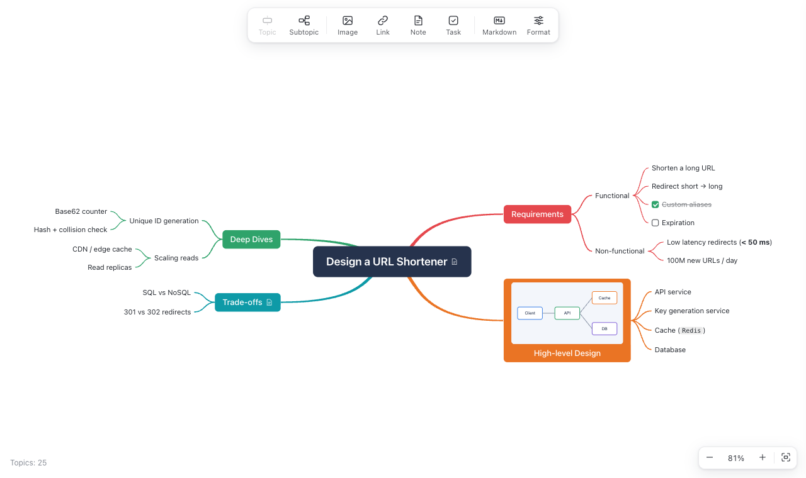
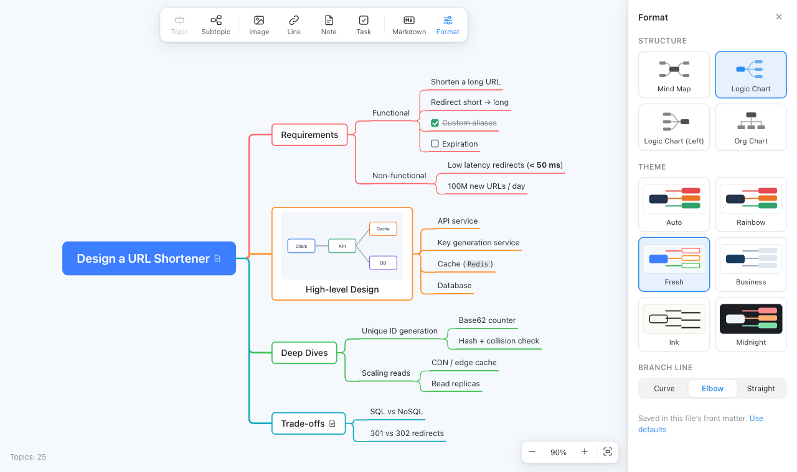
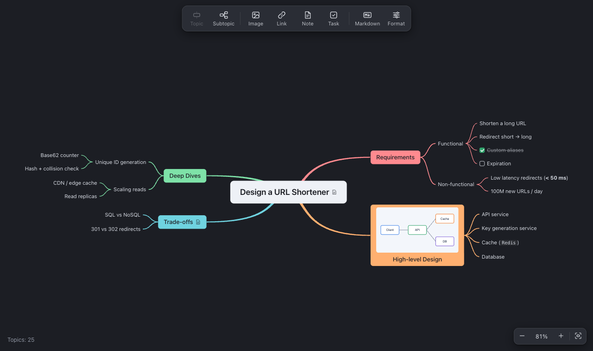
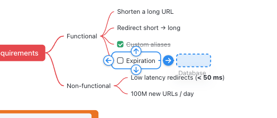

<p align="center">
  
</p>

<h1 align="center">Thinkmark</h1>

<p align="center">Edit Markdown files as XMind-style mind maps in VS Code.</p>

The `.md` file stays the source of truth. Every change you make in the map (adding, renaming, moving or deleting topics, images, notes, links, layout) is written back to the Markdown as a normal VS Code edit, so undo, redo, dirty state and save all work as usual. Every change you make to the text shows up in the map right away.



## Features

- **Markdown in, Markdown out.** Headings and lists become topics; paragraphs, code blocks and tables become topic notes. Editing a topic changes only that topic's line, and your heading levels, list markers and indentation are kept.
- **Keyboard-first editing.** `Tab` adds a subtopic, `Enter` adds a sibling, typing starts editing (IME friendly), arrow keys move around the map.
- **Drag and drop** with explicit placement: drop above, below, as a subtopic or as a new parent.
- **Box selection** and group actions: move, delete, copy, fold, link or tick several topics at once.
- **Images** inside topics: insert from a file, paste a screenshot, drop a file, resize by dragging.
- **Notes, task checkboxes, links** (`Cmd+K`) and inline formatting (bold, italic, code, links).
- **Spell check** for English while you edit a topic or a note, with suggestions and your own word list. It works offline.
- **Structures:** mind map, logic chart (right or left) and org chart. **Themes:** Rainbow, Fresh, Business, Ink, Midnight, or Auto to follow VS Code's light / dark theme. Curved, elbow or straight branch lines.
- **Side-by-side source:** the selected topic and the cursor in the Markdown editor follow each other.
- English and Simplified Chinese interface.

<p>
  
  
</p>

## Installation

Install **Thinkmark** from the [Visual Studio Marketplace](https://marketplace.visualstudio.com/items?itemName=illusion77.thinkmark): search for "Thinkmark" in the Extensions view, or run

```sh
code --install-extension illusion77.thinkmark
```

Requires VS Code 1.80 or newer.

To build it from source instead:

```sh
git clone https://github.com/illusion77/thinkmark.git
cd thinkmark
npm install
npm run package
code --install-extension thinkmark-*.vsix
```

## Usage

- Click the mind map icon in the title bar of a Markdown editor to open the map beside the text.
- Or right-click a `.md` file and choose **Open as Mind Map**, or run **Thinkmark: Open as Mind Map** from the Command Palette.
- **Thinkmark: New Mind Map…** creates a new file from a template.
- Files named `*.mm.md` or `*.mindmap.md` open as a mind map by default.
- Click **Markdown** in the toolbar to show the source next to the map.

## Markdown format

| Markdown | Mind map |
| --- | --- |
| The only top-level heading | Central topic |
| Several top-level headings, or none | The central topic is the file name |
| Sub-headings | Subtopics, nested by level |
| List items, nested by indentation | Subtopics of the heading or item above |
| Paragraphs, code blocks, tables, quotes | The topic's note |
| The first image on a topic line | Topic image; an optional width is stored after the alt text, e.g. `architecture\|240` |
| A topic line that is a single Markdown link | Topic link |
| `- [ ] task` / `- [x] done` | Task checkbox |
| `<br>` | Line break inside a topic |

```markdown
# Design a URL Shortener

## Requirements

- Functional
  - [x] Custom aliases
  - [ ] Expiration

## High-level Design 

## Trade-offs <!-- mindmap: left -->

Consistency vs availability for the alias namespace.

- SQL vs NoSQL
```

New topics follow the style of their siblings. A topic without siblings becomes a heading for the first two levels of the map and a list item below that (setting `thinkmark.headingLevels`).

In the mind map structure, main topics are placed on the right of the central topic. A main topic you move to the left is marked with `<!-- mindmap: left -->`, which Markdown previews do not show. A topic width you set by dragging is stored the same way, e.g. `<!-- mindmap: width=320 -->` or `<!-- mindmap: left, width=320 -->`.

Structure, theme and line style chosen in the Format panel are saved in the file's front matter:

```yaml
---
mindmap:
  layout: right      # map | right | left | down
  theme: fresh       # auto | rainbow | fresh | business | ink | midnight
  lineStyle: elbow   # curve | elbow | straight
---
```

## Editing

Shortcuts are shown for macOS. On Windows and Linux, use `Ctrl` instead of `Cmd` and `Alt` instead of `Option`.

| Action | Shortcut |
| --- | --- |
| Insert subtopic | `Tab` |
| Insert topic after / before | `Enter` / `Shift+Enter` |
| Insert parent topic | `Cmd+Enter` |
| Edit text | `F2`, `Space`, double-click, or start typing |
| New line inside a topic | `Shift+Enter` while editing |
| Finish / cancel editing | `Enter` / `Esc` |
| Delete | `Delete` / `Backspace` |
| Move among siblings | `Option+↑` / `Option+↓` |
| Navigate | Arrow keys; `Shift+Tab` goes to the parent, `Home` to the central topic |
| Select several topics | Drag a box on empty space (`Shift` or `Cmd` adds), `Shift` / `Cmd`-click, `Cmd+A` |
| Fold / unfold | `Cmd+/` |
| Bold / italic / underline | `Cmd+B` / `Cmd+I` / `Cmd+U`: the selected text while editing, or the whole text of the selected topics. Underline is written as `<u>text</u>` |
| Topic width | Drag the topic's outer edge (the left edge for topics left of the center) to set the width its text wraps at; shorter text keeps the topic narrower. Double-click the edge or right-click → Reset Width to go back to the default |
| Link | `Cmd+K` |
| Note | `F4` |
| Insert image | `Shift+Cmd+I` |
| Copy / cut / paste topics | `Cmd+C` / `Cmd+X` / `Cmd+V` (as a Markdown list) |
| Undo / redo | `Cmd+Z` / `Shift+Cmd+Z` |
| Zoom | `Cmd+=` / `Cmd+-`, `Cmd+0` for 100%, `Shift+1` or `Shift+Cmd+0` to fit, pinch or `Cmd`+scroll |
| Pan | Trackpad or mouse wheel, right-drag, `Space`+drag, middle-drag or `Option`+drag |

Right-click a topic, an image, a selection or the background for more commands.

### Spell check

While you edit a topic or a note, misspelled English words get a wavy underline (the word you are typing is checked once you move on). Rest the mouse on an underlined word and a small popover lists the likely spellings; click one to replace the word. **Add to Dictionary**, the last entry of the popover, accepts the word from now on; those words are kept in the setting `thinkmark.spellCheck.userWords`.

The dictionary is American English plus common software terms, and it is part of the extension: nothing you type leaves your machine. Code, links, file names, ACRONYMS, ProductNames, words with digits and text in other languages are not checked. Turn the feature off with `thinkmark.spellCheck.enabled`.

### Drag and drop

Drag a topic near another topic and four arrows appear around it. The highlighted arrow decides where the topic goes, and a placeholder previews the result:

| Arrow | Mind map and logic chart | Org chart |
| --- | --- | --- |
| Up | Sibling before | New parent |
| Down | Sibling after | Subtopic |
| Pointing away from the central topic | Subtopic | — |
| Pointing toward the central topic | New parent | — |
| Left / right | — | Sibling before / after |

Dropping onto the topic itself also makes it a subtopic. Next to the central topic, left and right choose the side of the map. Press `Esc` to cancel.



### Images

- **Image** in the toolbar picks a file. Files from outside the workspace are copied into an `assets` folder next to the Markdown file (setting `thinkmark.imageFolder`).
- Paste an image from the clipboard, or drop image files onto a topic (hold `Shift` while dropping from the file manager).
- Click an image to select it: drag the handle to resize, press `Delete` to remove it from the topic, or right-click for more options. Double-click to open it.
- Removing an image from a topic leaves the file in place. **Thinkmark: Clean Up Unused Images…** lists the images that no Markdown, HTML or text file in the workspace refers to, and moves the ones you select to the Trash.

### Links

`Cmd+K` opens a link field under the selected topic. Enter a URL or a file path; a domain such as `example.com` gets `https://` added. The topic then shows a link icon, which opens the link when clicked. With several topics selected, the link is added to all of them.

## Settings

| Setting | Default | Description |
| --- | --- | --- |
| `thinkmark.imageFolder` | `assets` | Folder, relative to the Markdown file, for pasted, dropped and inserted images |
| `thinkmark.defaultLayout` | `map` | Structure when the file does not set one |
| `thinkmark.defaultTheme` | `auto` | Theme when the file does not set one |
| `thinkmark.defaultLineStyle` | `curve` | Branch line style when the file does not set one |
| `thinkmark.headingLevels` | `2` | Map levels written as headings for new topics without siblings |
| `thinkmark.topicMaxWidth.centralTopic` | `26` | Longest line of the central topic before it wraps, in characters (one Chinese character or about two Latin letters each) |
| `thinkmark.topicMaxWidth.mainTopics` | `32` | Same for the main topics |
| `thinkmark.topicMaxWidth.subtopics` | `44` | Same for all deeper topics |
| `thinkmark.syncSelection` | `true` | Keep the selected topic and the cursor in a side-by-side Markdown editor in sync |
| `thinkmark.spellCheck.enabled` | `true` | Underline misspelled English words while editing a topic or a note |
| `thinkmark.spellCheck.userWords` | `[]` | Words the spell checker accepts in addition to its dictionary; a lower-case word also covers its capitalized form |

## Development

```sh
npm install
npm run build          # extension and webview bundles
npm run watch          # rebuild on change
npm test               # unit tests (parser, serializer, text diff, spell check)
npm run harness        # the webview in a browser with a mocked VS Code API: dev/harness.html
npm run test:vscode    # smoke test in an isolated VS Code window (macOS)
npm run package        # build thinkmark-<version>.vsix
```

Press `F5` in VS Code to start an Extension Development Host.

Project layout:

- `src/shared/markdown.ts` converts between Markdown and the topic tree.
- `src/mindmapEditor.ts` is the custom text editor that keeps the document and the webview in sync.
- `src/webview/` contains the map: layout, branch drawing, themes and interaction.
- `src/spell/` is the spell checker, which runs in the extension because VS Code turns off the browser's own in webviews; `src/webview/spell.ts` draws its marks.

## License

[MIT](LICENSE)

Spell checking uses [nspell](https://github.com/wooorm/nspell) (MIT) and the en-US Hunspell dictionary from [SCOWL](http://wordlist.aspell.net) (MIT and BSD), packaged as [dictionary-en](https://github.com/wooorm/dictionaries). Their license texts ship with the extension in `dist/THIRD-PARTY-LICENSES.txt`.
