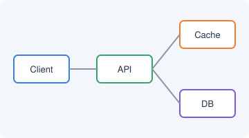

# Design a URL Shortener

Classic system design interview question.

## Requirements

- Functional
  - Shorten a long URL
  - Redirect short → long
  - [x] Custom aliases
  - [ ] Expiration
- Non-functional
  - Low latency redirects (**< 50 ms**)
  - 100M new URLs / day

## High-level Design 

- API service
- Key generation service
- Cache (`Redis`)
- Database

## Deep Dives <!-- mindmap: left -->

- Unique ID generation
  - Base62 counter
  - Hash + collision check
- Scaling reads
  - CDN / edge cache
  - Read replicas

## Trade-offs <!-- mindmap: left -->

Consistency vs availability for the alias namespace.

- SQL vs NoSQL
- 301 vs 302 redirects
